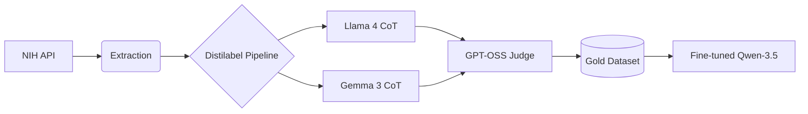

# Synthetic-CoT-Clinical-Policy-Summarizer


Translating complex clinical research into actionable policy insights using synthetic Chain-of-Thought (CoT) reasoning and model distillation.

## 📖 Overview

This project provides a robust pipeline for bridging the gap between dense medical research and public policy. Using **ClinicalTrials.gov** data as a foundation, the system generates high-fidelity summaries designed for policymakers, grant-givers, and health regulators.

It makes use of a **Synthetic CoT Pipeline**: using large "Teacher" models (Llama 4 Scout & Gemma 3) to generate logical reasoning trajectories, which are then used to fine-tune a more efficient "Student" model (Qwen-3.5).



### Key Features
* **Automated Retrieval:** Logic to pull and parse clinical trial data.
* **CoT Distillation:** Generates step-by-step reasoning for summaries to minimize hallucinations.
* **LLM-as-Judge:** Uses a `gpt-oss-120b` judge to score and filter synthetic responses.
* **Policy-Focused Output:** Translates efficacy, safety, and dosage data into social impact and regulatory relevance.

## 🛠️ Tech Stack

* **Orchestration:** LiteLLM & Groq API
* **Teacher Models:** Llama 4 Scout (17b-16e), Gemma 3 (27b)
* **Judge Model:** GPT-OSS (120b)
* **Student Model:** Qwen-3.5 (Fine-tuned)
* **Data Source:** ClinicalTrials.gov (Public Domain)

## Project Status: Staged Release

This repository currently contains the **full source code and pipeline architecture**. 

* **Code:** ✅ Available
* **Dataset:** ⏳ Pending release on Hugging Face (Synthetic CoT Clinical-Policy Gold-Set)
* **Model Weights:** ⏳ Pending release on Hugging Face (Llama-Qwen-Clinical-Translator)

## 📂 Repository Structure

```
Synthetic-CoT-Clinical-Policy-Summarizer/
├── data/               # Sample clinical trial datasets [HIDDEN_FILES]
├── outputs/            # Local storage for generated artifacts [HIDDEN_FILES]
├── outputs/            # [HIDDEN_FILES]
├── notebooks/
│   ├── 01_data_extraction_and_exploration
│   ├── 02_distilabel_CoT_pipeline
│   ├── 03_distilabel_judge_pipeline
│   ├── 04_silver2gold
│   ├── 05_qwen3_14b_reasoning_conversational
│   └── 06_evaluation
├── src/
│   ├── core.py         # Distilabel utils: ThrottledTextGeneration, CheckpointStep, etc.
│   ├── utils.py        # General helper functions
│   └── clients/
│       ├── clinical_trials.py  # NIH API parsing logic
│       └── llm_providers.py    # Model availability and limit checks
├── requirements.txt    # Dependency list
└── README.md           # You are here
```

## ⚖️ License & Attribution

### Code License
The source code in this repository is released under the **MIT License**.

### Model & Data Attribution
* **Built with Llama:** This project utilizes synthetic outputs from **Llama 4 Scout** and adheres to the Llama 4 Community License.
* **Gemma 3:** Synthetic trajectories include data generated via Google's **Gemma 3** models under the Gemma Terms of Use.
* **Data:** Source trial data is provided by **ClinicalTrials.gov** (NIH).

## ⚠️ Disclaimer

*This project is for research and portfolio demonstration purposes only. The summaries generated are synthetic and have not been validated by medical professionals. This tool is NOT a substitute for professional medical or regulatory advice.*

*Exploring the intersection of Reasoning Models and Healthcare Policy.*